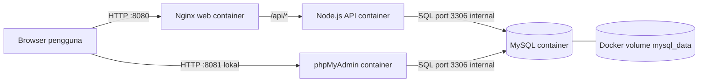

# Stokly — Website Inventaris CRUD untuk UTS DevOps

Stokly adalah website pengelolaan inventaris barang dengan **CRUD nyata (Create, Read, Update, Delete)** dan database **MySQL**. Frontend dibuat menggunakan **HTML, CSS, dan JavaScript murni**; backend menggunakan **Node.js + Express** sebagai penghubung aman ke database. Proyek ini sudah disiapkan untuk dijalankan dalam **4 container Docker (termasuk phpMyAdmin)** dan dilengkapi workflow **GitHub Actions CI/CD**.

> **Cakupan:** Contoh aplikasi pembelajaran, tanpa login. Cocok untuk demo lokal dan penilaian UTS. **Jangan publikasikan port web secara terbuka ke internet tanpa menambahkan autentikasi, HTTPS, dan hardening produksi.**

## 1. Fitur yang tersedia

- **Create:** Tambah barang (nama, kode SKU, kategori, stok, harga).
- **Read:** Tampilkan seluruh barang dari database MySQL.
- **Update:** Edit informasi barang yang sudah ada.
- **Delete:** Hapus barang dengan konfirmasi.
- Cari berdasarkan nama atau SKU, filter kategori, urutkan barang, dan pagination.
- Dashboard total jenis barang, jumlah unit, stok menipis, dan nilai inventaris.
- Ekspor data yang tampil ke CSV.
- Validasi di frontend **dan** backend; SKU unik di database.
- Tampilan responsif untuk laptop dan ponsel.
- Halaman **phpMyAdmin** di `http://localhost:8081` untuk melihat tabel MySQL melalui browser.

## 2. Arsitektur aplikasi



| Container | Teknologi | Peran |
| --- | --- | --- |
| `web` | Nginx + HTML/CSS/JS | Menyajikan tampilan website dan meneruskan `/api` |
| `api` | Node.js + Express + mysql2 | Menangani CRUD dan validasi |
| `db` | MySQL 8.4 | Menyimpan tabel `items` di volume persisten |
| `phpmyadmin` | phpMyAdmin 5.2 | Mengelola MySQL melalui browser di port 8081 |

**Catatan:** JavaScript di browser tidak terhubung langsung ke MySQL. Browser memanggil API Node.js; API kemudian menjalankan SQL terparameter untuk menghindari SQL injection.

## 3. Persiapan (Windows)

1. Instal **Docker Desktop** dan pastikan Docker Engine berjalan (misalnya melalui WSL2).
2. Instal **Git** dan **Visual Studio Code** jika belum ada.
3. Ekstrak file ZIP proyek; buka folder `inventaris-docker-uts` di VS Code.
4. Buka terminal VS Code pada folder yang memuat `compose.yaml`.
5. Salin file konfigurasi contoh:

   **PowerShell:**

   ```powershell
   Copy-Item .env.example .env
   ```

   **CMD:**

   ```cmd
   copy .env.example .env
   ```

6. Untuk penggunaan di luar demo lokal, ganti password pada `.env` dengan yang kuat. Jangan unggah `.env` ke GitHub.

## 4. Menjalankan website dengan Docker

Jalankan:

```bash
docker compose up -d --build
```

Pada kali pertama Docker mengunduh image MySQL, Node.js, dan Nginx. Tunggu hingga seluruh layanan siap (biasanya perlu beberapa saat untuk MySQL pertama kali).

Periksa status:

```bash
docker compose ps
```

Kemudian buka:

- **http://localhost:8080** — website CRUD Stokly.
- **http://localhost:8081** — phpMyAdmin untuk melihat database.

### Login phpMyAdmin (port 8081)

Gunakan akun yang dibuat oleh container MySQL dari file `.env`:

| Kolom phpMyAdmin | Nilai untuk konfigurasi contoh |
| --- | --- |
| Username | `inventaris_app` |
| Password | `ubah-password-aplikasi-ini` |

Setelah login, pilih database `inventaris_db`, lalu klik tabel **`items`** dan tab **Browse** untuk melihat barang. Jika kamu sudah mengubah `.env`, gunakan `MYSQL_USER` dan `MYSQL_PASSWORD` yang baru. phpMyAdmin berjalan **di container sendiri**, sedangkan MySQL tetap berada di container `db`. Port 8081 digunakan untuk halaman administrasi, bukan port SQL MySQL.

Untuk keamanan demo, phpMyAdmin hanya dipublikasikan di `127.0.0.1` komputer lokal, bukan ke semua perangkat jaringan. Konfigurasi produksi `compose.prod.yaml` tidak menjalankan phpMyAdmin.

Untuk melihat log bila ada kendala:

```bash
docker compose logs -f
```

Untuk menghentikan seluruh container tanpa menghapus data:

```bash
docker compose down
```

Untuk menjalankan lagi:

```bash
docker compose up -d
```

**Penting:** Perintah `docker compose down -v` akan **menghapus volume MySQL beserta seluruh data barang**. Gunakan hanya jika Anda sengaja ingin reset database (misalnya untuk mengulang pengujian dari data contoh).

### Melihat database dari terminal

```bash
docker compose exec db sh -c 'MYSQL_PWD="$MYSQL_PASSWORD" mysql -u "$MYSQL_USER" -D "$MYSQL_DATABASE" -e "SELECT * FROM items;"'
```

Script SQL awal `database/init.sql` hanya dijalankan saat **volume MySQL pertama kali dibuat**. Data yang ditambah, diubah, atau dihapus sesudahnya akan bertahan saat container di-restart.

## 5. Alur demonstrasi CRUD

1. Buka dashboard dan tunjukkan enam data contoh.
2. Klik **Tambah Barang**. Isi misalnya `Monitor 24 Inch`, SKU `ELK-010`, kategori `Elektronik`, stok `7`, harga `1750000`.
3. Klik **Simpan Barang**, lalu cari `Monitor` di pencarian. Data baru sudah tersimpan di MySQL.
4. Klik ikon **edit** pada Monitor; ubah stok dari `7` menjadi `3`. Status menjadi **Stok Menipis** dan ringkasan otomatis berubah.
5. Klik ikon **hapus** untuk Monitor, lalu konfirmasi. Item menghilang dari daftar dan database.
6. Jalankan perintah `SELECT * FROM items` di atas untuk menunjukkan bahwa data memang berubah di MySQL.
   Alternatifnya, buka **http://localhost:8081** dan pilih database `inventaris_db` → tabel `items` → **Browse**.
7. Hentikan dan nyalakan kembali container; data yang tersisa tetap ada berkat Docker volume.

## 6. Pengujian otomatis

Untuk menguji validasi backend (memerlukan Node.js di komputer):

```bash
npm ci --prefix backend
npm test --prefix backend
```

Ketika container sudah menyala, jalankan tes CRUD end-to-end:

```bash
node scripts/smoke-test.mjs
```

Tes end-to-end otomatis akan membuat satu barang sementara, membacanya, mengeditnya, lalu menghapusnya. Hasil yang diharapkan adalah **semua tes lulus**.

## 7. CI/CD GitHub Actions

Workflow terletak di `.github/workflows/ci-cd.yml`.

**CI (Continuous Integration) — otomatis pada push/PR ke `main`:**

1. Install dependencies.
2. Periksa sintaks JavaScript dan unit test.
3. Bangun dan jalankan 4 container melalui Docker Compose.
4. Jalankan pengujian CRUD end-to-end.
5. Hentikan container pengujian.

**CD (Continuous Delivery) — otomatis setelah CI lulus pada push ke `main`:**

1. Build image Docker `api` dan `web`.
2. Publish dua image ke **GitHub Container Registry (GHCR)**, dengan tag `latest` dan commit SHA.
3. **Opsional:** Deploy kedua image ke VPS melalui SSH setelah variabel deployment diaktifkan. Ini adalah **Continuous Deployment** jika server benar-benar dikonfigurasi.

### Mengaktifkan pipeline di GitHub

1. Buat repository GitHub baru, misalnya `stokly-inventaris-uts`.
2. Upload seluruh isi proyek termasuk folder tersembunyi `.github` (jangan upload `.env`).
3. Pastikan branch utama bernama `main`.
4. Push perubahan ke `main`, lalu buka tab **Actions** di repository.
5. Periksa workflow `CI/CD - Stokly Inventory`, job `test` dan `publish`. Secara default GitHub menyediakan `GITHUB_TOKEN`; job `publish` memakai izin `packages: write`.
6. Bila paket image private, akses ke image di VPS harus diatur dengan `docker login ghcr.io`. Untuk demo, menunjukkan job `publish` berhasil sudah membuktikan proses continuous delivery, tetapi **belum berarti aplikasi otomatis ter-deploy**.

### Deployment otomatis ke VPS (opsional, perlu server sendiri)

Proses deploy tidak aktif secara default. Ini karena server VPS dan kredensial SSH harus milik Anda sendiri.

1. Siapkan VPS Linux dengan Docker Engine + Docker Compose plugin, lalu buat folder misalnya `/srv/stokly` beserta `database/`.
2. Buat file `/srv/stokly/.env` secara manual di VPS, sesuai `.env.example` dengan password kuat. Jangan kirim password melalui GitHub.
3. Atur akses login image GHCR pada VPS (jika image private) dan pastikan user SSH dapat menjalankan perintah Docker.
4. Di GitHub repository: **Settings → Secrets and variables → Actions**. Tambahkan secrets:
   - `DEPLOY_HOST`: alamat IP/domain VPS
   - `DEPLOY_USER`: username Linux untuk SSH
   - `DEPLOY_SSH_KEY`: private key SSH khusus deployment
   - `DEPLOY_KNOWN_HOSTS`: fingerprint SSH server yang **diverifikasi secara independen**
5. Tambahkan repository variables:
   - `ENABLE_VPS_DEPLOY` = `true`
   - `DEPLOY_PATH` = `/srv/stokly`
6. Push ke branch `main`. Setelah tes dan publikasi image sukses, job `deploy` mengirim Compose config ke VPS lalu menjalankan `docker compose pull` dan `up -d`.

> **Keamanan produksi:** Website demonstrasi ini belum memakai sistem login/role. Untuk deployment publik yang sebenarnya, wajib ditambah autentikasi, HTTPS, firewall, backup data, pembatasan akses API, dan pengelolaan secrets yang layak. Jangan membuka MySQL ke publik.

## 8. Rekomendasi video UTS (sesuai rubrik)

**Video 1 — Implementasi container (5–8 menit):**

1. Tunjukkan struktur proyek di VS Code dan jelaskan fungsi `web`, `api`, `db`, `phpmyadmin`.
2. Tunjukkan `Dockerfile` frontend/backend dan `compose.yaml`.
3. Jalankan `docker compose up -d --build` dan `docker compose ps`.
4. Buka `http://localhost:8080` dan lakukan Create, Read, Update, Delete.
5. Buka phpMyAdmin di port 8081, tampilkan database `inventaris_db`, lalu buktikan perubahan pada tabel `items` dan volume persisten.

**Video 2 — CI/CD (3–5 menit):**

1. Tampilkan isi `.github/workflows/ci-cd.yml`.
2. Lakukan perubahan kecil lalu commit dan push ke `main`.
3. Buka tab GitHub Actions: jelaskan tes, build container, dan smoke test.
4. Tunjukkan dua image yang dipublikasikan ke GHCR.
5. Jika memakai VPS, tunjukkan job `deploy` dan website yang diperbarui otomatis. Jika tidak, jelaskan bahwa pipeline mencakup **CI + continuous delivery image**, sedangkan deployment VPS masih opsional.

## 9. Rekomendasi isi laporan Word UTS

1. Judul: **Implementasi Docker dan CI/CD pada Aplikasi Stokly Inventory Berbasis Web**.
2. Nama aplikasi dan seluruh nama/NIM anggota kelompok.
3. Latar belakang, tujuan, dan deskripsi singkat aplikasi.
4. Teknologi: HTML, CSS, JavaScript, Node.js, Express, MySQL, Nginx, Docker Compose, GitHub Actions.
5. Cara menjalankan aplikasi dan tabel fitur CRUD.
6. Diagram arsitektur container (pada bagian 2 README ini).
7. Screenshot container aktif, tampilan CRUD, database, dan proses CI/CD.
8. Tautan repository GitHub (sumber kode), video container, dan video CI/CD.
9. Kesimpulan dan pembagian tugas kelompok.
10. Simpan dengan nama sesuai instruksi dosen: `UTS_[NIM_Salah_Satu_Perwakilan_Kelompok].docx`.

## 10. Struktur folder

```text
inventaris-docker-uts/
├── .github/workflows/ci-cd.yml    # CI/CD GitHub Actions
├── backend/
│   ├── Dockerfile
│   ├── package.json
│   ├── package-lock.json
│   ├── src/db.js                 # Koneksi MySQL
│   ├── src/server.js             # REST API CRUD
│   ├── src/validation.js         # Validasi input
│   └── test/validation.test.js    # Unit tests
├── database/init.sql             # Tabel MySQL dan data contoh
├── frontend/
│   ├── Dockerfile
│   ├── nginx.conf
│   ├── index.html
│   ├── styles.css
│   └── app.js
├── scripts/smoke-test.mjs        # Uji CRUD lewat HTTP
├── .env.example
├── compose.yaml                  # 4 container lokal
├── compose.prod.yaml             # VPS opsional
└── README.md
```

## 11. Rute API

| Method | Endpoint | Fungsi |
| --- | --- | --- |
| `GET` | `/api/health` | Cek API + koneksi MySQL |
| `GET` | `/api/items` | Baca semua barang |
| `GET` | `/api/items/:id` | Baca detail barang |
| `POST` | `/api/items` | Tambah barang |
| `PUT` | `/api/items/:id` | Edit barang |
| `DELETE` | `/api/items/:id` | Hapus barang |

Contoh JSON untuk `POST` dan `PUT`:

```json
{
  "sku": "ELK-010",
  "name": "Monitor 24 Inch",
  "category": "Elektronik",
  "stock": 7,
  "price": 1750000
}
```

---

**Saran untuk UTS:** Utamakan aplikasi bekerja baik saat demo di laptop sendiri. Setelah itu push ke GitHub untuk merekam bukti otomatis CI/CD. Workflow yang disertakan belum menjadi bukti implementasi sampai benar-benar dijalankan di repository GitHub Anda.

